# Opa! 👋 Eu sou o Lucas Felipe

🎓 **Estudante de Engenharia de Software na UEM**
💻 **Estagiário de Desenvolvimento de Software na Netcare**

Gosto de me aventurar pelo mundo da tecnologia e explorar diferentes áreas da computação. Atualmente, concilio a graduação em Engenharia de Software com meu estágio na **Netcare**, enquanto continuo aprendendo, experimentando e criando meus próprios projetos.

Por aqui você vai encontrar projetos de estudo, experimentação e, ocasionalmente, algumas ideias que achei divertidas de transformar em código. 🚀

Agradeço ao [Alfred Baudisch](https://github.com/alfredbaudisch) e ao [Gustavo Guanabara](https://github.com/gustavoguanabara) por terem me introduzido ao mundo da programação!

---

## 🛠️ Tecnologias e Ferramentas

  

---

## 📊 Estatísticas do GitHub

  
  

---

## 🔥 Sequência de Contribuições

  

---

## 📈 Atividade

  

---

## 🐍 Jogo da Cobrinha de Contribuições

  <picture>
    <source
      media="(prefers-color-scheme: dark)"
      srcset="https://raw.githubusercontent.com/LucassFelipe/LucassFelipe/output/github-snake-dark.svg"
    />
    <source
      media="(prefers-color-scheme: light)"
      srcset="https://raw.githubusercontent.com/LucassFelipe/LucassFelipe/output/github-snake.svg"
    />
    
  </picture>

---

## 🚀 Projetos em Destaque

* ☀️ [**Planetary System Simulator**](https://github.com/LucassFelipe/Planetary-System-Simulator) — Simulador de sistemas planetários com física e o Sistema Solar como padrão, incluindo uma sonda controlável. O projeto é feito em Python com Pygame.

* ▶️ [**Youtuber War Simulator**](https://github.com/LucassFelipe/YoutuberWarSimulator) — Simulador inspirado na disputa entre PewDiePie e T-Series, desenvolvido em Python.

* 💰 [**Organizador de Finanças**](https://github.com/LucassFelipe/organizador-de-financas) — Aplicativo mobile para controle financeiro pessoal, desenvolvido com Expo, React Native e NativeWind.

---

  <i>Obrigado por visitar meu perfil! 👋</i>

